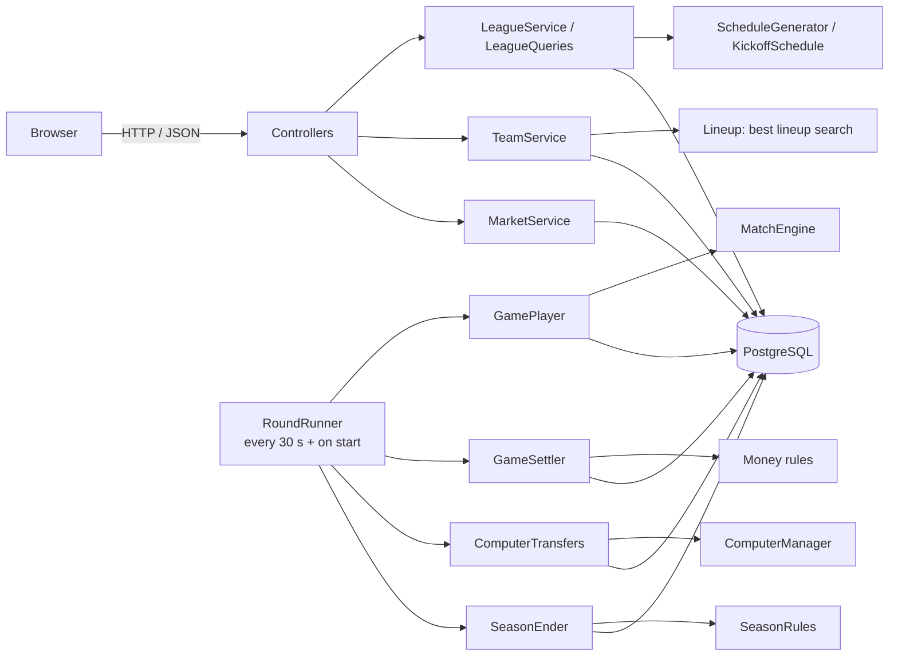

# Friends League – Football Manager

[](https://github.com/barakes/FriendsLeague/actions/workflows/ci.yml)

An online football manager game for a private league of friends. Each friend manages a team, sets the lineup,
buys and sells footballers and manages the money, while computer teams fill the empty places.
The rounds are played at fixed times and broadcast live, minute by minute, without spoilers.
Hebrew interface, works on phones.

**Play it:** https://friendsleague.onrender.com
*(Free hosting: outside the evening hours, the first visit can take about 2 minutes while the server wakes up.)*

---

## How the game works

- **Leagues of 6, 8, 10 or 12 teams.** One friend opens a league and shares a 6-character code; computer teams fill the empty places when the season starts.
- **Squads.** Every team starts with 18 fictional footballers (position, rating 1-99, age) with the same average rating, so nobody starts ahead.
- **Lineups.** A formation (4-4-2, 4-3-3, 3-5-2, 5-3-2, 4-5-1), a tactic (attacking, balanced, defensive) and the 11 players. A player out of his position plays weaker. One button picks the strongest lineup.
- **Rounds** are played at the kick-off times the league's creator chose (up to 4 a day, Israel time). A double round-robin; 3 points for a win, 1 for a draw.
- **Live broadcast:** 90 game minutes take 4.5 real minutes. Goals appear at the minute they "happen", and the table changes only when the broadcast ends.
- **Money.** TV rights, home tickets, win and draw bonuses, a sponsor (safe or risky) and end-of-season prizes; wages are paid every round.
- **Debt.** A team below zero can't buy. After 3 rounds in a row in debt it loses 3 points, and again every 3 rounds. Footballers are never sold automatically.
- **Transfer market.** Free agents from ordinary players to stars. Selling returns 70% of the price.
- **Computer teams** use the market too: they buy the free agent who improves their best lineup the most, keep a reserve for wages, and sell when in debt.
- **Seasons.** Prizes and a champion; footballers get older (young ones improve, old ones decline), retire at 36, and small squads get academy players. New friends can join between seasons and take over a computer team.

## Tech stack

| Area | Technology |
|---|---|
| Language | Java 25 |
| Framework | Spring Boot 4.1 (Web MVC, Data JPA, scheduling) |
| Database | PostgreSQL (Neon), Flyway migrations, Hibernate schema validation |
| Security | BCrypt password hashing (Spring Security Crypto), SHA-256 hashed login tokens |
| Client | Plain HTML, CSS and JavaScript (no framework) |
| Tests | JUnit, AssertJ, MockMvc, Testcontainers |
| CI/CD | GitHub Actions (tests on every push, a scheduled job that keeps the server awake in the evening), Docker, Render |

## Architecture



The game rules – the match engine, the best-lineup search, the schedule, the table, prices, money, the computer
manager and the season rules – are plain Java with no framework code. They are fast to test, and were calibrated
with simulations of thousands of seasons. The services around them load data, call the rules and save the result.

## Design decisions

### The match and the live broadcast
- **The whole game is computed at kick-off** and saved with every goal's minute. The broadcast only reveals what is already saved, by the time that passed since kick-off (3 seconds per game minute). The browser asks every 3 seconds during a broadcast and every 30 seconds otherwise.
- **No spoilers, anywhere.** During a broadcast the server sends only goals up to the current minute. The table counts a game only after its broadcast ends, and its money (bonuses, sponsor, points lost for debt) is paid only then, because a win bonus in the team's account would give the result away.
- **A sleeping server loses nothing.** Free hosting sleeps when nobody visits. When it wakes up, it plays and pays every missed game in kick-off order, and the broadcast still counts from the original kick-off time.
- **A balanced match engine.** Each team's attack and defense come from its lines (goalkeeper, defense, midfield, attack) with weights chosen so no formation is stronger by itself. Expected goals grow with the strength ratio, with a small home advantage; goals are drawn minute by minute. Simulations were used to tune it: about 2.7 goals a game, realistic draws, and a 10-point stronger team wins about 61% of the time.
- **The best lineup is exact.** The "pick my lineup" button (and every computer team) uses dynamic programming over the free places in each line, checked against a full search on thousands of random squads.

### Money and the market
- **Every payment is a row** in the team's account history, and the money in the team always equals the starting money plus every row (tested).
- **No double spending, no double buying.** A purchase locks the team's row and then the footballer's row (`select ... for update`), always in that order, so two clicks or two friends at the same moment are handled one after the other, and two purchases can never wait for each other forever.
- **The computer manager** checks each free agent by how much he would improve its best lineup. A quick check first skips anyone who isn't better than the weakest player in his line, so the full search runs only for real candidates.

### Seasons
- **The end of a season runs in one transaction**: prizes, the champion, aging, retirement, academy players and the new market are saved together, or not at all. The league's row is locked, so it can never run twice.
- **Past champions are saved by name**, so the list stays right even if a friend later takes over and renames that team.

### Accounts and security
- **Passwords**: only a BCrypt hash is stored. **Login tokens**: the browser gets a random token; the database keeps only its SHA-256 hash.
- **The server never trusts the browser**: every request is checked against the logged-in account (a member of the league, the manager of the team), and every lineup is validated against the squad and the formation.
- **Text typed by players is never inserted as HTML**, so a team name can't inject code into other players' pages.

## Database

| Table | Holds |
|---|---|
| `accounts`, `login_tokens` | users and hashed login tokens |
| `leagues` | name, join code, size, kick-off times, season, status |
| `teams` | manager (or none for a computer team), money, formation, tactic, sponsor, debt counters |
| `lineup_slots` | the saved lineup: which footballer plays in which line |
| `footballers` | every footballer of the league; no team = on the market |
| `games`, `game_goals` | the schedule, results and every goal's minute and scorer |
| `money_entries` | the account history of every team |
| `season_champions` | the champion of every finished season |

## Running locally

Requirements: Java 25, a PostgreSQL database, and Docker (for the tests).

Set the database connection as environment variables (never in the code):

```
DATABASE_URL=jdbc:postgresql://<host>/<database>?sslmode=require
DATABASE_USERNAME=<user>
DATABASE_PASSWORD=<password>
```

Then:

```bash
./mvnw spring-boot:run
```

and open http://localhost:8080. Flyway creates the tables on the first start.

## Tests

```bash
./mvnw test
```

166 tests:
- **Game rules**: squads and names, the best-lineup search, the match engine, the schedule, the table and tie-breakers, kick-off times (including daylight saving time), the live clock.
- **Money and market**: prices, wages, income, prizes, debt rules, the market generator, squad limits, the computer manager.
- **Seasons**: aging, retirement and the academy.
- **With a real PostgreSQL in Testcontainers**: accounts and the HTTP endpoints, creating and joining leagues, playing rounds, the spoiler-free live view, paying money only after the broadcast, buying and selling, computer transfers, and whole seasons from the first round to the next season.

## Roadmap

- Notifications before a round starts
- Injuries and cards
- A cup with penalty shoot-outs
- Trades between friends
- Stadium upgrades and a youth academy to invest in
